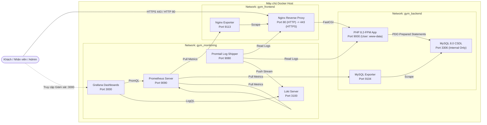

# ĐỀ TÀI 23: HỆ THỐNG QUẢN LÝ PHÒNG GYM / FITNESS (TITAN FITNESS)

Dự án đồ án kết thúc học phần: Xây dựng hệ thống ứng dụng web quản lý phòng Gym/Fitness toàn diện kết hợp kiến trúc DevOps hiện đại (Nginx Reverse Proxy, MySQL 8.0, Prometheus, Grafana, Loki và Promtail) chạy trên nền tảng Docker Compose.

---

## 1. Giới Thiệu Đề Tài

**Titan Fitness Management System** là hệ thống phần mềm quản lý phòng tập Gym và Fitness chuyên nghiệp, hỗ trợ tối ưu hóa quy trình vận hành phòng tập: quản lý hội viên, quản lý đội ngũ huấn luyện viên thể hình cá nhân (PT), quản lý các gói thẻ dịch vụ, hợp đồng đăng ký gói tập, sắp xếp lịch tập không bị trùng ca, và theo dõi doanh thu thời gian thực qua Dashboard trực quan.

Đặc biệt, hệ thống được trang bị bộ giải pháp **DevOps Observability Stack** đạt chuẩn doanh nghiệp, cho phép tự động giám sát toàn bộ tài nguyên máy chủ, lưu lượng mạng, tình trạng cơ sở dữ liệu và quản lý log tập trung.

---

## 2. Công Nghệ Sử Dụng

- **Môi trường phát triển:** VS Code trên hệ điều hành Windows.
- **Backend máy chủ:** PHP 8.2 thuần (Pure PHP), kết nối CSDL qua thư viện **PDO**, sử dụng **Prepared Statements** chống SQL Injection, lưu trữ mật khẩu bằng thuật toán an toàn **BCRYPT** (`password_hash`), xác thực phiên làm việc (`Session Guard`) và phân quyền vai trò người dùng (Role-Based Access Control). Không sử dụng framework nặng nhằm tối ưu hiệu năng và thể hiện rõ cấu trúc mã nguồn.
- **Giao diện người dùng (Frontend):** HTML5, Vanilla CSS hiện đại (Dark Slate + Neon Emerald Aesthetic, Glassmorphism, Responsive Mobile/Desktop), JavaScript thuần xử lý kiểm tra biểu mẫu (Validation) và thư viện **Chart.js v4** (được nhúng offline trực tiếp trong mã nguồn, không phụ thuộc internet).
- **Cơ sở dữ liệu:** MySQL 8.0 (InnoDB Engine, UTF8MB4 Unicode, ràng buộc khóa ngoại Foreign Keys, Indexes tối ưu truy vấn).
- **Điều phối hạ tầng (DevOps Containerization):** Docker Compose v2 điều phối toàn bộ 7 dịch vụ chính và 2 exporters.
- **Reverse Proxy & Web Server:** Nginx Alpine (cấu hình chuyển tiếp FastCGI, chứng chỉ bảo mật HTTPS SSL tự ký, bảo vệ bằng HTTP Security Headers).
- **Giám sát số liệu (Metrics):** Prometheus Server thu thập số liệu từ `nginx-prometheus-exporter` và `mysqld_exporter`.
- **Trực quan hóa (Visualization):** Grafana Server tự động nạp (Auto-provisioning) 2 Dashboard giám sát hệ thống và CSDL.
- **Thu thập & Truy vấn Log:** Grafana Loki và Promtail thu gom tự động log truy cập Nginx và log kiểm toán ứng dụng PHP theo thời gian thực.
- **Quản lý phiên bản:** Git và GitHub.

---

## 3. Các Chức Năng Website Quản Lý Gym

### 3.1. Đăng nhập và Phân quyền (Authentication & Authorization)
- Đăng nhập an toàn, đăng xuất xóa sạch session và cookie phiên.
- Phân quyền 2 cấp độ:
  - **Quản trị viên (Admin):** Toàn quyền quản trị hệ thống, quản lý hội viên, HLV, gói tập, đăng ký thẻ, lịch tập, xóa dữ liệu và xem nhật ký hệ thống.
  - **Nhân viên (Staff):** Đăng ký hội viên mới, xếp lịch tập, đăng ký gói tập, xem danh sách. Bị hạn chế quyền xóa bản ghi quan trọng.
- Bảo mật mật khẩu bằng `password_hash($pass, PASSWORD_BCRYPT)` và xác thực bằng `password_verify()`.
- Chống tấn công Session Fixation bằng hàm `session_regenerate_id(true)` khi đăng nhập thành công.
- Tự động chặn và điều hướng người chưa đăng nhập về trang `/login.php`.

### 3.2. Quản lý Hội viên (Members Management)
- Xem danh sách hội viên kèm bộ lọc trạng thái (Đang hoạt động, Tạm hoãn, Ngưng hoạt động).
- Tìm kiếm tức thời theo: Mã hội viên, Họ tên, Số điện thoại, Email.
- Thêm mới hội viên: Kiểm tra tính hợp lệ của định dạng Email, Số điện thoại (9-11 số), tự động phát hiện và chặn trùng Mã hội viên hoặc Email.
- Chỉnh sửa hồ sơ và xem trang chi tiết hội viên (hiển thị thông tin cá nhân, lịch sử các gói tập đã đăng ký, danh sách các buổi tập đã hẹn).
- Xóa hội viên (chỉ dành cho Quản trị viên).

### 3.3. Quản lý Gói tập (Packages) & Đăng ký Thẻ (Memberships)
- **Quản lý danh mục gói tập:** Thêm, sửa, xóa các gói dịch vụ (1 tháng, 3 tháng, 6 tháng, 12 tháng, Kickfit...), cấu hình thời hạn (ngày) và giá tiền niêm yết.
- **Đăng ký gói tập cho hội viên:**
  - Chọn hội viên và chọn gói tập.
  - Tự động tính toán ngày hết hạn dựa trên ngày bắt đầu và thời hạn của gói tập đã chọn.
  - Tự động điền số tiền niêm yết của gói, quản lý trạng thái thanh toán (`paid`, `pending`).
  - Hệ thống tự động chuyển trạng thái sang `expired` (Hết hạn) khi ngày hiện tại vượt quá ngày hết hạn của hợp đồng.

### 3.4. Quản lý Huấn luyện viên (Trainers Management)
- Thêm, sửa, xóa, tìm kiếm huấn luyện viên theo chuyên môn (Thể hình & Tăng cơ, Yoga & Pilates, Cardio & Giảm cân, Kickboxing).
- Lưu trữ mã HLV, họ tên, điện thoại, email, tiểu sử kinh nghiệm và trạng thái làm việc.
- Kiểm tra toàn vẹn dữ liệu: Không cho phép xóa HLV nếu đang có ca tập trong tương lai liên kết với HLV đó.

### 3.5. Quản lý Lịch tập Cá nhân (Training Schedules)
- Đặt lịch tập cá nhân kèm huấn luyện viên: Chọn hội viên, chọn HLV, ngày tập, giờ bắt đầu và giờ kết thúc.
- Kiểm tra tính hợp lệ của thời gian (Giờ kết thúc phải sau giờ bắt đầu).
- **Kiểm tra xung đột lịch tập (Overlap Schedule Conflict Check):** Thuật toán tự động quét trong CSDL để đảm bảo 1 HLV không bị xếp trùng 2 ca tập cùng 1 khung giờ trong cùng 1 ngày. Báo lỗi chi tiết nếu phát hiện trùng giờ.
- Hỗ trợ đổi giờ tập, cập nhật trạng thái (Đã lên lịch, Đã hoàn thành, Đã hủy) hoặc xóa ca tập.

### 3.6. Dashboard Thống Kê & Báo Cáo Thời Gian Thực
- Truy vấn trực tiếp 100% từ MySQL CSDL (không dùng số liệu tĩnh/giả lập):
  - Tổng số hội viên & Số hội viên đang hoạt động.
  - Số gói tập còn hạn và số gói tập đã hết hạn.
  - Tổng số huấn luyện viên đang sẵn sàng.
  - Số ca tập trong ngày hôm nay (`CURDATE()`).
  - Tổng doanh thu thực thu từ các gói tập.
- Biểu đồ phân bổ trạng thái hội viên & gói tập (Doughnut Chart).
- Biểu đồ doanh thu theo từng gói tập (Bar Chart).
- Bảng tổng hợp các ca tập diễn ra trong ngày hôm nay để lễ tân theo dõi.

---

## 4. Sơ Đồ Kiến Trúc Hệ Thống



---

## 5. Thiết Kế Cơ Sở Dữ Liệu MySQL

Hệ thống sử dụng cơ sở dữ liệu `gym_management`. Toàn bộ định nghĩa bảng, chỉ mục và dữ liệu mẫu được lưu trong tệp: `database/gym_management.sql`.

### Các bảng dữ liệu chính:
1. **`users`**: Quản lý tài khoản đăng nhập (`admin`, `staff`), mật khẩu băm Bcrypt.
2. **`members`**: Hồ sơ hội viên phòng tập, mã HV duy nhất, thông tin liên lạc, ngày đăng ký, trạng thái.
3. **`trainers`**: Danh sách huấn luyện viên thể hình, chuyên môn, tiểu sử, trạng thái làm việc.
4. **`packages`**: Các gói dịch vụ tập luyện, thời hạn ngày, giá tiền niêm yết.
5. **`memberships`**: Hợp đồng đăng ký gói tập của hội viên, ngày bắt đầu, ngày hết hạn, thanh toán, trạng thái còn hạn/hết hạn. Khóa ngoại liên kết `members` và `packages`.
6. **`training_schedules`**: Lịch tập cá nhân giữa hội viên và huấn luyện viên, ngày tập, giờ bắt đầu, giờ kết thúc. Khóa ngoại liên kết `members` và `trainers`.
7. **`system_logs`**: Nhật ký hoạt động kiểm toán trong ứng dụng.

---

## 6. Hướng Dẫn Cài Đặt và Khởi Chạy Hệ Thống

### 6.1. Yêu cầu Tiền đề (Prerequisites)
- Đã cài đặt **Docker Desktop** (bản dành cho Windows có hỗ trợ WSL2).
- Đã cài đặt **Git** và **Visual Studio Code**.

### 6.2. Hướng dẫn Mở dự án trong VS Code
1. Khởi động phần mềm **VS Code**.
2. Chọn menu **File -> Open Folder...** (hoặc nhấn `Ctrl + K, Ctrl + O`).
3. Điều hướng và chọn thư mục dự án `d:\Quản lý phòng gym`.

### 6.3. Cấu hình biến môi trường (`.env`)
1. Trong thư mục gốc của dự án, sao chép tệp mẫu `.env.example` thành `.env`:
   ```powershell
   Copy-Item .env.example .env
   ```
2. Mở file `.env` và kiểm tra cấu hình mật khẩu (đã được cấu hình sẵn các giá trị an toàn cho môi trường chạy thử):
   ```ini
   MYSQL_ROOT_PASSWORD=GymRootAdmin@2026!
   MYSQL_DATABASE=gym_management
   MYSQL_USER=gym_user
   MYSQL_PASSWORD=GymSecret@2026
   DB_HOST=mysql
   DB_PORT=3306
   APP_PORT_HTTP=80
   APP_PORT_HTTPS=443
   PROMETHEUS_PORT=9090
   GRAFANA_PORT=3000
   LOKI_PORT=3100
   ```

### 6.4. Khởi chạy toàn bộ hệ thống bằng Docker Compose
Mở Terminal trong VS Code (`Ctrl + ~`) hoặc PowerShell tại thư mục dự án, chạy lệnh duy nhất:

```powershell
docker compose up -d --build
```

Lệnh này sẽ tự động:
1. Build container PHP-FPM từ `Dockerfile`.
2. Khởi tạo container MySQL 8.0, tự động chạy script `database/gym_management.sql` để tạo cấu trúc bảng và seed data.
3. Khởi tạo Nginx với cấu hình SSL và Reverse Proxy.
4. Khởi chạy 2 Exporters giám sát MySQL và Nginx.
5. Khởi chạy Prometheus, Grafana, Loki và Promtail.

Kiểm tra trạng thái các container đang chạy:
```powershell
docker compose ps
```

---

## 7. Hướng Dẫn Truy Cập và Kiểm Tra Website

### 7.1. Truy cập Website Quản lý Gym
- **Giao thức HTTPS:** Mở trình duyệt web truy cập `https://localhost` (hoặc `https://127.0.0.1`).
  - *Lưu ý về SSL tự ký:* Vì sử dụng chứng chỉ SSL tự ký phục vụ demo nội bộ, trình duyệt có thể hiển thị cảnh báo *"Kết nối của bạn không phải là kết nối riêng tư"*. Bạn chỉ cần nhấn **Nâng cao (Advanced)** -> Chọn **Tiếp tục truy cập localhost (Proceed to localhost)**.
- **Giao thức HTTP:** Khi truy cập `http://localhost`, Nginx sẽ tự động chuyển hướng (Redirect 301) sang `https://localhost` để đảm bảo an toàn.

### 7.2. Tài khoản Demo có sẵn
| Vai trò | Tên đăng nhập | Mật khẩu | Quyền hạn |
|---|---|---|---|
| **Quản trị viên (Admin)** | `admin` | `Admin@123` | Toàn quyền quản trị hệ thống, quản lý hội viên, HLV, gói tập, xếp lịch, xóa bản ghi, xem nhật ký. |
| **Nhân viên (Staff)** | `staff` | `Staff@123` | Lễ tân: Đăng ký hội viên, xếp lịch tập, đăng ký gói tập. Không có quyền xóa bản ghi. |

*(Tại giao diện đăng nhập có 2 nút "Admin" và "Staff" hỗ trợ bấm điền tự động nhanh chóng để trình bày).*

### 7.3. Truy cập Công Cụ Quản Lý Cơ Sở Dữ Liệu (phpMyAdmin)
- **Địa chỉ:** `http://localhost:8080`
- **Tài khoản đăng nhập phpMyAdmin:**
  - **Người dùng ứng dụng (Application User):**
    - Máy chủ (Server): `mysql`
    - Tên người dùng: `gym_user`
    - Mật khẩu: `GymSecret@2026`
  - **Quản trị viên CSDL (Root Admin):**
    - Máy chủ (Server): `mysql`
    - Tên người dùng: `root`
    - Mật khẩu: `GymRootAdmin@2026!`
- **Cơ sở dữ liệu:** Chọn database `gym_management` để xem danh sách 7 bảng và dữ liệu mẫu.

---

## 8. Hướng Dẫn Giám Sát: Prometheus, Grafana, Loki

### 8.1. Kiểm tra Prometheus
- Truy cập: `http://localhost:9090`
- Vào menu **Status -> Targets**: Kiểm tra 3 target `prometheus`, `nginx`, `mysql` đều hiển thị trạng thái xanh `UP (1/1)`.

### 8.2. Kiểm tra Grafana Dashboards
- Truy cập: `http://localhost:3000`
- Đăng nhập: tài khoản `admin` / `admin`.
- Vào menu **Dashboards -> Titan Fitness Monitoring**:
  - Mở dashboard **Titan Fitness - System & Services Overview**: Xem trạng thái các dịch vụ, lưu lượng request Nginx, active connections, và khung hiển thị nhật ký thời gian thực.
  - Mở dashboard **Titan Fitness - MySQL Performance Overview**: Xem thời gian uptime MySQL, tần suất truy vấn (QPS), số kết nối client.

### 8.3. Truy vấn Nhật ký với Loki qua Grafana Explore
- Trong Grafana, vào menu **Explore** (biểu tượng la bàn bên trái), chọn Data source là **Loki**.
- Thực hiện **3 truy vấn LogQL bắt buộc theo đề bài**:

1. **Truy vấn log truy cập Nginx:**
   ```logql
   {job="nginx", logtype="access"}
   ```
2. **Truy vấn log lỗi HTTP 5xx:**
   ```logql
   {job="nginx", logtype="access"} | json | status >= 500
   ```
3. **Truy vấn log theo từ khóa hoặc mức độ nghiêm trọng:**
   ```logql
   {job="app"} | json | level =~ "WARNING|ERROR|CRITICAL"
   ```
   Hoặc truy vấn từ khóa đăng nhập thành công:
   ```logql
   {job="app"} |= "LOGIN_SUCCESS"
   ```

---

## 9. Các Biện Pháp Hardening & Bảo Mật Đã Triển Khai

Dự án áp dụng đầy đủ các biện pháp bảo mật thực tế theo yêu cầu đề bài:

1. **Chạy ứng dụng với User phi Root (Least Privilege):** Container PHP-FPM được cấu hình chuyển quyền thực thi sang user `www-data`, không chạy dưới quyền `root`.
2. **Không công khai cổng MySQL ra bên ngoài (Port Exposure Minimization):** Cổng 3306 của MySQL hoàn toàn không được map ra máy chủ host trong `docker-compose.yml`. Chỉ các container trong mạng nội bộ mới có thể kết nối tới CSDL.
3. **Tách biệt mạng phân tầng (Docker Network Segregation):** Tách 3 mạng độc lập: `gym_frontend`, `gym_backend` và `gym_monitoring` nhằm cách ly dữ liệu quan trọng khỏi mặt ngoài.
4. **Bảo vệ bằng HTTP Security Headers trên Nginx:** Cấu hình đầy đủ các header an toàn: `X-Frame-Options: SAMEORIGIN` (chống Clickjacking), `X-Content-Type-Options: nosniff` (chống MIME-sniffing), `X-XSS-Protection`, `Strict-Transport-Security` (ép buộc HTTPS), và `Referrer-Policy`.
5. **Chống tấn công SQL Injection:** 100% câu truy vấn dữ liệu phía backend PHP đều sử dụng PDO Prepared Statements với tham số ràng buộc an toàn (`execute([':param' => $value])`).
6. **Lưu trữ mật khẩu bằng chuẩn BCRYPT:** Sử dụng hàm `password_hash()` của PHP với độ phức tạp cao, không bao giờ lưu mật khẩu dạng văn bản thô (plaintext).
7. **Bảo vệ phiên làm việc và chống Session Fixation:** Cấu hình cờ `HttpOnly`, `SameSite=Lax` cho cookie phiên, tự động gọi `session_regenerate_id(true)` ngay khi đăng nhập.
8. **Chống tấn công CSRF (Cross-Site Request Forgery):** Mọi biểu mẫu form POST đều có trường ẩn `csrf_token` được sinh ngẫu nhiên bằng `random_bytes(32)` và kiểm tra chặt chẽ trước khi xử lý dữ liệu.
9. **Không commit thông tin bí mật:** Sử dụng `.gitignore` để loại bỏ tệp `.env` chứa mật khẩu nhạy cảm, chỉ chia sẻ `.env.example`.

---

## 10. Hướng Dẫn Xử Lý Lỗi Thường Gặp (Troubleshooting)

| Tình huống lỗi | Nguyên nhân | Cách khắc phục |
|---|---|---|
| `docker: failed to connect to the docker API` | Docker Desktop chưa được bật trên máy tính. | Bật phần mềm Docker Desktop trên Windows và đợi biểu tượng chuyển sang màu xanh (Engine running). |
| Trình duyệt báo `Privacy error / Cảnh báo bảo mật` khi vào HTTPS | Nginx đang sử dụng chứng chỉ SSL tự ký local. | Bấm nút **Nâng cao (Advanced)** -> Chọn **Tiếp tục truy cập localhost (Proceed to localhost)**. |
| Không kết nối được MySQL từ ứng dụng PHP | Container MySQL đang khởi động và chưa chạy xong script nạp CSDL. | Đợi khoảng 10-15 giây để MySQL hoàn tất `healthcheck`. Có thể kiểm tra bằng lệnh: `docker compose logs -f mysql`. |
| Cổng 80 hoặc 443 bị báo `Address already in use` | Máy tính đang có ứng dụng web khác (IIS, Apache XAMPP, Skype) chiếm cổng 80/443. | Mở file `.env`, đổi `APP_PORT_HTTP=8080` và `APP_PORT_HTTPS=8443`, sau đó chạy lại `docker compose up -d`. |
| Không thấy log trong Grafana Loki | Promtail vừa khởi động hoặc chưa có request nào được gửi đến. | Truy cập vài trang trên website để phát sinh log truy cập, sau đó bấm nút **Run query** trong Grafana Explore. |

---

## 11. Danh Sách Ảnh Chụp Màn Hình Cần Chuẩn Bị Cho Báo Cáo

Khi nộp báo cáo kết thúc học phần, bạn cần chụp các ảnh minh chứng thực tế sau:

1. **Ảnh 1:** Giao diện VS Code mở đầy đủ cấu trúc thư mục dự án và cửa sổ Terminal chạy `docker compose ps` hiển thị đầy đủ các container đều `running (healthy)`.
2. **Ảnh 2:** Màn hình đăng nhập `https://localhost/login.php` trên trình duyệt kèm 2 nút điền tài khoản demo.
3. **Ảnh 3:** Giao diện **Dashboard thống kê** với các thẻ KPI, biểu đồ tròn phân bổ và biểu đồ cột doanh thu theo gói tập.
4. **Ảnh 4:** Bảng danh sách hội viên kèm tính năng tìm kiếm và xem chi tiết hồ sơ hội viên.
5. **Ảnh 5:** Giao diện thêm mới hoặc chỉnh sửa lịch tập hiển thị thông báo ngăn chặn khi phát hiện **xung đột giờ tập của huấn luyện viên**.
6. **Ảnh 6:** Giao diện công cụ quản lý cơ sở dữ liệu **phpMyAdmin** (`http://localhost:8080`) hiển thị cấu trúc CSDL `gym_management` và dữ liệu các bảng.
7. **Ảnh 7:** Giao diện Prometheus (`http://localhost:9090/targets`) hiển thị các target `nginx`, `mysql` ở trạng thái `UP`.
8. **Ảnh 8:** Giao diện Grafana Dashboard **Titan Fitness - System & Services Overview** hiển thị đầy đủ số liệu và biểu đồ.
9. **Ảnh 9:** Giao diện Grafana Dashboard **Titan Fitness - MySQL Performance Overview** hiển thị các chỉ số CSDL.
10. **Ảnh 10:** Giao diện Grafana Explore thực hiện thành công 3 truy vấn LogQL thu thập log từ Nginx và PHP Application.
11. **Ảnh 11:** Lịch sử các commit trên Git (`git log --oneline`).

---

## 12. Kế Hoạch 3 Git Commit

Dự án được phân chia thành 3 giai đoạn commit rõ ràng theo yêu cầu đề bài:
- **Commit 1:** `feat: hoàn thành ứng dụng quản lý Gym PHP thuần, CSDL MySQL và Nginx reverse proxy SSL`
- **Commit 2:** `feat: hoàn thành cấu hình Prometheus, Grafana và dashboards giám sát dịch vụ`
- **Commit 3:** `feat: hoàn thành cấu hình Loki, Promtail, LogQL queries, hardening bảo mật và tài liệu báo cáo`
