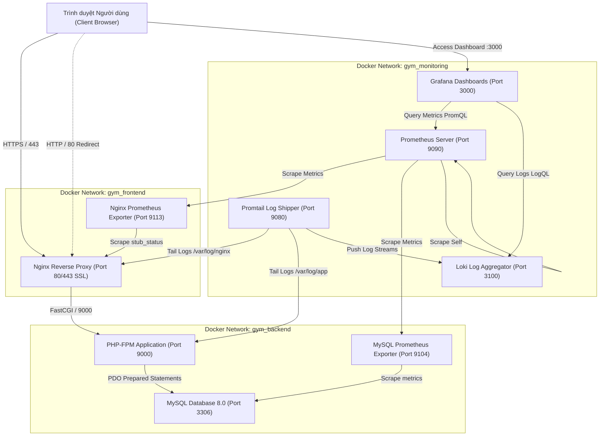

# KIẾN TRÚC HỆ THỐNG QUẢN LÝ PHÒNG GYM (TITAN FITNESS)

## 1. Tổng quan Kiến trúc

Hệ thống Quản lý Phòng Gym & Fitness được thiết kế theo kiến trúc Micro-services hóa trên nền tảng **Docker Compose**, phân tách độc lập các lớp:
- **Presentation & Web Tier:** Nginx Reverse Proxy (SSL/HTTPS, Security Headers, Static Assets Caching).
- **Application Tier:** PHP 8.2-FPM (xử lý nghiệp vụ thuần, session auth, validation, PDO prepared statements).
- **Database Tier:** MySQL 8.0 (CSDL quan hệ InnoDB, persistent storage, isolated internal network).
- **Monitoring & Observability Tier:**
  - Prometheus: Thu thập số liệu metrics từ Nginx & MySQL.
  - Grafana: Trực quan hóa dữ liệu hiệu năng, trạng thái hệ thống và log streams.
  - Loki & Promtail: Thu gom tập trung log truy cập Nginx và audit log ứng dụng PHP.

---

## 2. Các Thành phần Dịch vụ Chi tiết

| Tên Dịch Vụ | Công Nghệ / Image | Cổng Nội Bộ | Cổng Mở Ra Host | Mục Đích & Trách Nhiệm |
|---|---|---|---|---|
| **Nginx** | `nginx:alpine` | 80, 443 | 80, 443 | Tiếp nhận traffic người dùng, xử lý chứng chỉ SSL tự ký, gán HTTP Security Headers, phục vụ static assets (`css`, `js`), proxy FastCGI sang App. |
| **App** | `php:8.2-fpm-alpine` | 9000 | Không mở | Chạy ứng dụng PHP thuần, kết nối CSDL qua PDO, xác thực phiên đăng nhập, kiểm tra xung đột lịch tập. Chạy dưới user `www-data`. |
| **MySQL** | `mysql:8.0` | 3306 | Không mở | CSDL quan hệ lưu trữ thông tin hội viên, huấn luyện viên, gói tập, hợp đồng và lịch tập. Dữ liệu lưu bền vững trong Docker volume `mysql_data`. |
| **Prometheus** | `prom/prometheus:v2.50.0` | 9090 | 9090 | Máy chủ giám sát thời gian thực, định kỳ kéo metrics từ các exporters mỗi 5 giây. |
| **Grafana** | `grafana/grafana:10.3.3` | 3000 | 3000 | Giao diện hiển thị trực quan hóa Dashboard giám sát tải CPU/RAM, số kết nối MySQL, QPS và nhật ký lỗi. |
| **Loki** | `grafana/loki:3.0.0` | 3100 | 3100 | Hệ thống lưu trữ và đánh chỉ mục nhật ký log tập trung theo nhãn (labels). |
| **Promtail** | `grafana/promtail:3.0.0` | 9080 | Không mở | Agent thu thập file log từ Nginx (`access.log`, `error.log`) và ứng dụng PHP (`app.log`), đóng gói JSON và gửi về Loki. |
| **MySQL Exporter** | `prom/mysqld-exporter` | 9104 | Không mở | Xuất các chỉ số hoạt động của MySQL (Queries, Threads, Innodb buffer) cho Prometheus. |
| **Nginx Exporter** | `nginx/nginx-prometheus-exporter` | 9113 | Không mở | Xuất các chỉ số HTTP request rate, active connections từ endpoint `stub_status`. |

---

## 3. Mô hình Mạng và Bảo Mật Phân Tầng (Network Segregation)

Hệ thống thiết lập 3 Docker Network riêng biệt:
1. `gym_frontend`: Chỉ dành cho Nginx và PHP Application giao tiếp, ngăn cách hoàn toàn với MySQL.
2. `gym_backend`: Chỉ dành cho PHP Application, MySQL và MySQL Exporter. Nginx và thế giới bên ngoài không thể truy cập trực tiếp vào port 3306 của MySQL.
3. `gym_monitoring`: Kết nối các thành phần giám sát (Prometheus, Grafana, Loki, Promtail, Exporters) để đảm bảo lưu lượng metrics không gây ảnh hưởng đến hiệu năng phục vụ người dùng.
