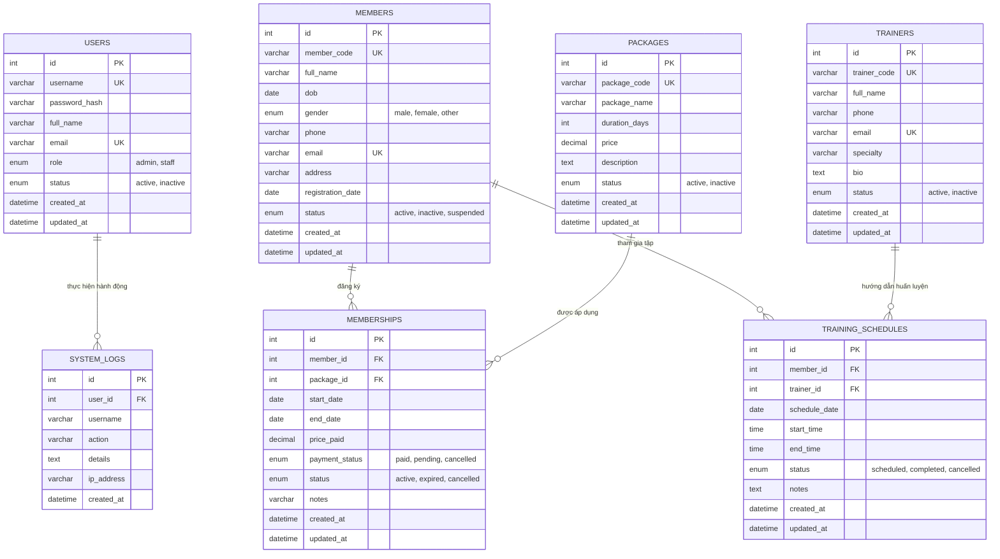

# THIẾT KẾ CƠ SỞ DỮ LIỆU GYM MANAGEMENT

## 1. Sơ đồ Thực thể Quan hệ (ERD - Entity Relationship Diagram)

---

## 2. Mô Tả Chi Tiết Các Bảng Dữ Liệu

### 2.1. Bảng `users` (Tài khoản & Phân quyền)
Lưu thông tin đăng nhập và vai trò quản trị viên (`admin`) hoặc nhân viên lễ tân (`staff`).
- `id`: Khóa chính tự tăng (INT).
- `username`: Tên đăng nhập duy nhất (`VARCHAR(50)`, UNIQUE).
- `password_hash`: Chuỗi băm mật khẩu an toàn theo thuật toán BCRYPT của PHP (`VARCHAR(255)`).
- `role`: Vai trò phân quyền (`ENUM('admin', 'staff')`).
- `status`: Trạng thái kích hoạt (`ENUM('active', 'inactive')`).

### 2.2. Bảng `members` (Hội viên)
Lưu trữ thông tin cá nhân và hồ sơ tập luyện của hội viên.
- `id`: Khóa chính (INT).
- `member_code`: Mã hội viên định danh duy nhất (`VARCHAR(20)`, UNIQUE, INDEX).
- `full_name`: Họ và tên đầy đủ (`VARCHAR(100)`).
- `dob`: Ngày tháng năm sinh (`DATE`).
- `gender`: Giới tính (`ENUM('male', 'female', 'other')`).
- `phone`: Số điện thoại (`VARCHAR(20)`, INDEX).
- `email`: Địa chỉ email duy nhất (`VARCHAR(100)`, UNIQUE).
- `registration_date`: Ngày bắt đầu đăng ký tham gia (`DATE`).
- `status`: Trạng thái (`ENUM('active', 'inactive', 'suspended')`).

### 2.3. Bảng `trainers` (Huấn luyện viên)
Lưu thông tin đội ngũ huấn luyện viên thể hình cá nhân (PT).
- `id`: Khóa chính (INT).
- `trainer_code`: Mã huấn luyện viên duy nhất (`VARCHAR(20)`, UNIQUE).
- `full_name`: Họ và tên (`VARCHAR(100)`).
- `phone`, `email`: Liên lạc (`VARCHAR`, UNIQUE cho email).
- `specialty`: Chuyên môn huấn luyện (Bodybuilding, Cardio/HIIT, Yoga, Kickfit, Boxing).
- `status`: Trạng thái làm việc (`ENUM('active', 'inactive')`).

### 2.4. Bảng `packages` (Gói tập)
Lưu danh mục các gói thẻ hội viên phòng gym.
- `id`: Khóa chính (INT).
- `package_code`: Mã gói tập duy nhất (`VARCHAR(20)`, UNIQUE).
- `package_name`: Tên gói (VD: Gói Khởi Động 1 Tháng, Gói VIP 12 Tháng).
- `duration_days`: Thời hạn sử dụng tính bằng số ngày (`INT`).
- `price`: Giá niêm yết của gói (`DECIMAL(12,2)`).
- `status`: Trạng thái áp dụng (`ENUM('active', 'inactive')`).

### 2.5. Bảng `memberships` (Đăng ký gói tập của hội viên)
Lưu hợp đồng đăng ký giữa hội viên và gói dịch vụ tập luyện.
- `member_id`: Khóa ngoại liên kết `members.id` (ON DELETE CASCADE).
- `package_id`: Khóa ngoại liên kết `packages.id` (ON DELETE RESTRICT).
- `start_date`: Ngày kích hoạt gói tập (`DATE`).
- `end_date`: Ngày hết hạn gói tập (`DATE`).
- `price_paid`: Số tiền thực thu (`DECIMAL(12,2)`).
- `status`: Tình trạng hiệu lực (`active`: Còn hạn, `expired`: Hết hạn, `cancelled`: Đã hủy).

### 2.6. Bảng `training_schedules` (Lịch tập cá nhân)
Quản lý lịch hẹn tập giữa hội viên và huấn luyện viên.
- `member_id`: Khóa ngoại `members.id` (ON DELETE CASCADE).
- `trainer_id`: Khóa ngoại `trainers.id` (ON DELETE RESTRICT).
- `schedule_date`: Ngày diễn ra ca tập (`DATE`).
- `start_time`, `end_time`: Khung giờ tập luyện (`TIME`).
- `status`: Trạng thái ca tập (`scheduled`, `completed`, `cancelled`).
- **Chỉ mục kết hợp:** `idx_schedules_trainer_date (trainer_id, schedule_date)` để tối ưu truy vấn kiểm tra xung đột lịch.

### 2.7. Bảng `system_logs` (Nhật ký kiểm toán)
Lưu trữ vết hoạt động của người dùng trên giao diện web (đăng nhập, thêm/sửa/xóa).

---

## 3. Ràng buộc toàn vẹn & Tối ưu hóa Chỉ mục (Indexes)
- Toàn bộ bảng sử dụng Storage Engine **InnoDB** hỗ trợ ACID Transactions.
- Toàn bộ truy vấn phía backend PHP đều sử dụng **Prepared Statements** với tham số ràng buộc kiểu dữ liệu, ngăn ngừa 100% nguy cơ SQL Injection.
- Dữ liệu được bảo toàn tự động khi khởi động lại container nhờ Docker Named Volume `mysql_data`.
